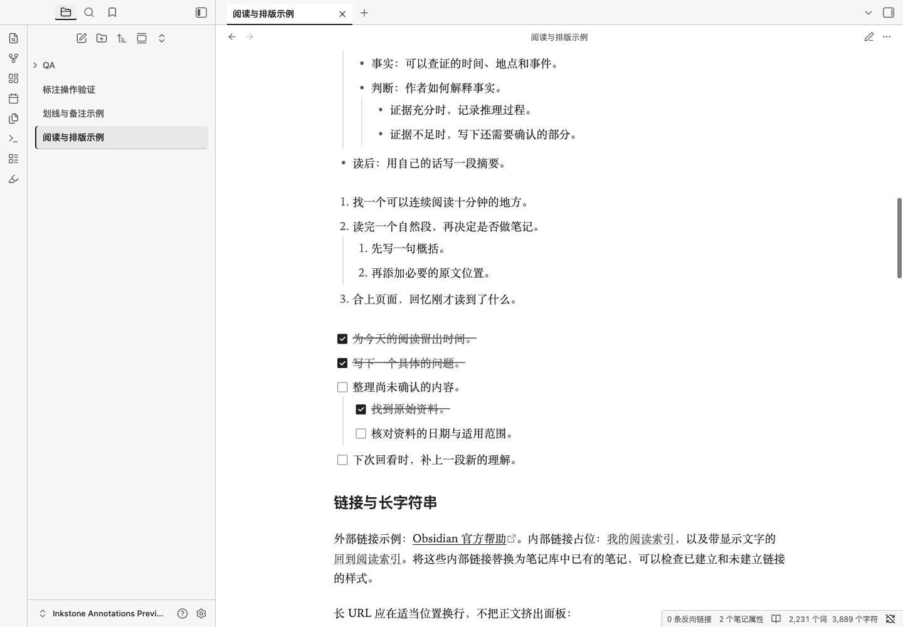

# Inkstone · 墨读

适合中文长文阅读和墨水屏的 Obsidian 浅色主题，附带可选的划线、高亮与备注插件。

白底、深灰正文、设备已有的衬线字体，默认 **18px 字号、1.75 倍行高、40em 行宽**。界面减少装饰和动画，链接、提示、操作状态在灰阶下仍可辨认。主题不下载字体，不依赖外部资源；配套插件只在本地处理笔记。

**[下载主题＋标注合集](https://github.com/bufan1024/obsidian-inkstone/releases/latest)** · **[安装教程](INSTALL.md)** · **[标注使用说明](annotations/README.md)**

## 效果截图

以下截图来自 macOS 上的 Obsidian 1.12.4，内容为仓库附带的示例笔记。

### 长文阅读



### 选中文字，添加划线和备注

右键选择「墨读：标注与备注…」，选择下划线或颜色，并填写备注。备注使用原生脚注保存在当前 Markdown 文件中。


### 彩色与墨水屏显示

开启「墨水屏显示」后，四色统一为浅灰底，用实线、双线、点线、虚线保留区别；切换显示不会改写笔记中保存的颜色。

| 彩色高亮 | 灰阶与不同线型 |
| --- | --- |
|  |  |

<details>
<summary>查看提示框与排版细节</summary>


</details>

## 用 Codex / AI 安装

先关闭要安装的 Obsidian 笔记库，再将下面的提示词复制给**能执行命令、访问本机文件**的 Codex 或其他 AI 编程助手。把路径替换为自己的笔记库绝对路径；如果只使用在线聊天，按[手动安装教程](INSTALL.md#手动安装)操作。

```text
请将 Inkstone 墨读主题和配套标注插件安装到我的 Obsidian 笔记库：
/替换为你的笔记库绝对路径
配置文件夹：.obsidian（如已自定义，请先替换为实际名称）

仓库：https://github.com/bufan1024/obsidian-inkstone

请直接执行安装：
1. 读取仓库的 README.md 和 INSTALL.md，将仓库克隆到临时目录。
2. 检查上述路径和指定的配置文件夹存在。
   如果路径缺失或配置文件夹不明确，请先向我确认，不要猜测或扫描其他笔记库。
3. 运行 python3 scripts/install.py --vault "上述绝对路径" --dry-run，
   再运行同一命令去掉 --dry-run。自定义配置目录时加 --config-dir "文件夹名"。
   Windows 可以使用 py -3 代替 python3。
4. 不要修改笔记正文、删除文件、覆盖插件 data.json 或改动其他插件设置。
   脚本会备份被替换的文件，不要绕过它直接覆盖已有配置。
5. 安装后检查主题和插件文件，告诉我备份位置，并提醒我重新打开 Obsidian，
   在「设置 → 第三方插件」关闭受限模式、启用「墨读标注 Inkstone Annotations」。

如果缺少 Git 或 Python 3，请说明缺少什么，并改用 Release 合集的手动安装方式。
不要安装到没有指定的笔记库，也不要只给我操作步骤。
```

脚本会安装文件、选用 Inkstone 浅色主题并开启可读行宽。**首次启用第三方插件需要在 Obsidian 中完成**；脚本不会关闭受限模式。只想阅读时，可加 `--theme-only`，无需启用任何插件。

## 一条命令安装

下载并解压 [Release 合集](https://github.com/bufan1024/obsidian-inkstone/releases/latest)，或克隆本仓库。在解压目录或仓库目录中运行（需要 Python 3，运行前关闭 Obsidian）：

```sh
python3 scripts/install.py --vault "/你的笔记库路径"
```

Windows 可用 `py -3 scripts/install.py --vault "D:\笔记库"`。脚本仅写入指定库的配置目录，覆盖前会备份不同的旧文件，重复运行不会重复备份相同内容。它保留其他配置项及插件数据。

不用命令行也可安装：将合集中的 `themes/Inkstone/` 和 `plugins/inkstone-annotations/` 分别复制到笔记库的 `.obsidian/themes/` 与 `.obsidian/plugins/`，然后在 Obsidian 中选择主题、启用插件。详见[完整安装与恢复教程](INSTALL.md)。

## 划线、高亮与备注

启用配套插件后，**选中文字 → 右键「墨读：标注与备注…」**，或从命令面板打开同名命令。

- 下划线、黄／绿／蓝／粉四色高亮，可附加多行备注。
- 备注作为原生脚注追加到当前笔记，点击脚注编号即可查看。
- 「墨水屏显示」在彩色与灰阶之间切换。
- 编辑视图可用系统撤销；阅读视图可执行「墨读：撤销上次标注」。

编辑视图支持同一源代码行内的普通文字；阅读视图支持原文为单行的纯文本段落。含链接、加粗、脚注或已有标记的段落，请切换编辑视图选择普通文字。编辑视图可能显示 HTML 标记，当前插件没有添加实时预览装饰。

主题仍是纯 CSS，只安装主题不会增加操作菜单。关闭插件后，Inkstone 主题仍可显示保存的标记与原生脚注。查看[完整命令与限制](annotations/README.md)，或复制[划线与备注示例](examples/划线与备注示例.md)到笔记库体验。

## 字体与阅读尺寸

主题尊重「设置 → 外观」中的原生字体家族设置。默认使用设备已有字体，不下载在线字体。

主题字号由 `--inkstone-font-size` 控制，外观中的全局字号滑块不会改变这一值。要调整字号、行高和行宽，在 `.obsidian/snippets/inkstone-reading.css` 写入下面内容，再在「设置 → 外观 → CSS 代码片段」启用：

```css
body.theme-light {
  --inkstone-font-size: 18px;
  --inkstone-line-height: 1.75;
  --inkstone-line-width: 40em;
}
```

例如，将字号改为 `20px` 可以放大正文，将行宽改为 `36em` 可以缩短每行。请开启「设置 → 编辑器 → 可读行宽」；窄窗口仍以可用宽度为限。

## 兼容与验证

- 主题与插件声明最低 Obsidian 版本为 **1.10.6**；实际验证版本为 macOS **1.12.4**。
- 阅读视图、实时预览、源码模式已验证，宽表格和代码块在各自区域横向滚动。
- 标注核心通过 24 项单元测试，原生应用通过 27 项标注交互检查及 63 项主题检查。详见[验证记录](VALIDATION.md)。

主要适配浅色模式。手机原生应用、实体墨水屏及其他 Obsidian 版本尚未实测，设备的刷新和残影由设备与系统决定。第三方插件自行绘制的界面可能需要单独适配。

## 开发与打包

使用仓库中已构建的文件安装时，不需要 Node.js。修改插件源码后，用 Node.js 22 或更新版本重新构建和测试：

```sh
node annotations/build.mjs
node --test annotations/tests/core.test.cjs
python3 -m unittest discover -s scripts -p 'test_*.py'
python3 scripts/package.py
```

构建和安装脚本均无第三方依赖。发布包生成到 `dist/`，包含独立主题、独立插件、主题与标注合集三种 ZIP。`.qa/` 与 `dist/` 不纳入源码仓库。

## 设计参考与许可

排版与留白参考 OpenDesign 的 [Paper](https://github.com/nexu-io/open-design/blob/main/design-systems/paper/DESIGN.md)、[Editorial](https://github.com/nexu-io/open-design/blob/main/design-systems/editorial/DESIGN.md) 和 [Minimal](https://github.com/nexu-io/open-design/blob/main/design-systems/minimal/DESIGN.md)，主题结构参考 [Obsidian 官方主题开发文档](https://docs.obsidian.md/Themes/App+themes/Build+a+theme)。

[MIT License](LICENSE)。问题反馈请附 Obsidian 版本、系统、使用视图、最小笔记片段及其他 CSS 代码片段情况。
