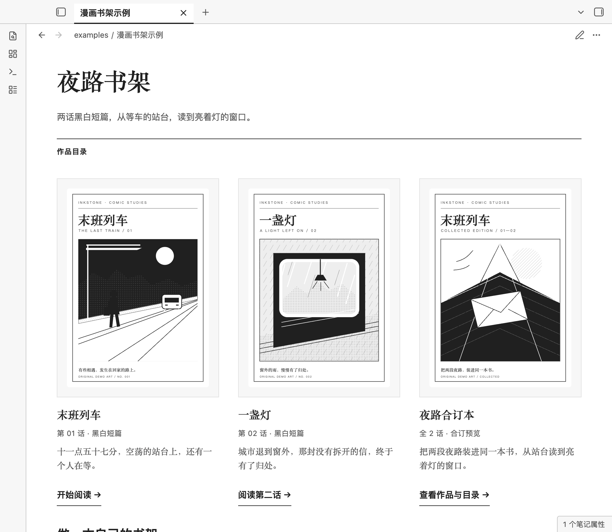

# Inkstone · 墨读

简体中文 · [English](README.en.md)

适合中文长文阅读和墨水屏的 Obsidian 浅色主题：安静阅读，随手划线、写想法，再把标注整理成摘录。

Inkstone is a light Obsidian theme for long-form reading and comics. It provides high-contrast typography, cover shelves, work details, chapter links, continuous image reading, and responsive two-page layouts. The theme works without plugins or external resources and follows Obsidian's font settings. The optional Inkstone Annotations plugin adds highlights, underlines, footnote thoughts, and excerpt export.

**[市场安装与更新（推荐）](#安装与更新)** · **[主题市场](https://community.obsidian.md/themes/inkstone)** · **[插件市场](https://community.obsidian.md/plugins/inkstone-annotations)** · **[标注使用说明](annotations/README.md)**

主题 **1.5.0** 已在 [GitHub Release](https://github.com/bufan1024/obsidian-inkstone/releases/tag/1.5.0) 发布，市场同步与审核状态以[主题市场页面](https://community.obsidian.md/themes/inkstone)为准。标注插件 **1.2.0** 已在[独立发行仓库](https://github.com/bufan1024/obsidian-inkstone-annotations/releases/tag/1.2.0)发布，新版本市场同步与审核状态以[插件市场页面](https://community.obsidian.md/plugins/inkstone-annotations)为准。白底、深灰正文，默认 1.75 倍行高、40em 行宽；字体和字号跟随 Obsidian「设置 → 外观」。只想阅读时，可以单独安装纯 CSS 主题。

## 看两段演示就能开始

动图录自 macOS Obsidian 1.14.4 的独立示例笔记库，展示较早版本的交互，部分文案可能不同。点击动图可查看原尺寸。

### 选中文字，写想法


1. 选中普通文字，点击快捷条的「写想法」。
2. 在原文旁的小浮层中输入想法，选择四色高亮或下划线，再点「保存想法」（`Cmd+Enter`／`Ctrl+Enter`）。切换样式不丢文字，保存前不改笔记；取消不写入。
3. 点击已有标记，直接改色、写想法或删除。小菜单首层选色立即生效；进入「写想法／编辑想法」后，样式与备注在保存时一起生效。

动画无法播放时，查看[写想法截图](preview-selection-idea.png)、[已有标注菜单](preview-annotation-menu.png)，或按[完整示例教程](#用一篇示例走完标注侧栏和导出)练习。

### 在侧栏编辑标注，再导出摘录


1. 从快捷条「更多 → 打开标注侧栏」，或执行同名命令，查看当前笔记的摘录和想法；点击「编辑」可改色或修改想法。
2. 搜索摘录或想法文字，并按颜色、下划线和「仅有想法」组合筛选。各条件须同时满足；切换笔记会重置条件。
3. 点击「导出全部」，在原笔记目录新建 Markdown，包含**全部**标注和备注，不受筛选影响。导出带来源、快照时间和章节路径，重名时加编号，不覆盖已有文件。

动画无法播放时，查看[侧栏截图](preview-workspace.png)和[侧栏与导出完整说明](annotations/README.md#当前笔记侧栏与摘录导出)。

## 安装与更新

### 从 Obsidian 市场安装（推荐）

先在 Obsidian 中打开要使用的笔记库。市场安装不需要 Git、Python 或构建工具；主题和标注插件是两个独立条目，需要分别安装。

1. **安装主题：** 打开「设置 → 外观 → 主题 → 管理」，搜索 **Inkstone**，选择后点击「安装并使用」（Install and use）。回到「设置 → 外观」，确认主题为 Inkstone、基础颜色为**浅色**；主题仅支持浅色，只需要阅读样式时安装主题即可。
2. **安装插件：** 打开「设置 → 第三方插件」，首次使用时按提示关闭「受限模式」。点击「浏览」（Browse），搜索 **Inkstone Annotations**（ID：`inkstone-annotations`），点击「安装」（Install），再点击「启用」（Enable）；也可在「已安装插件」中打开它的开关。安装主题不会自动安装或启用插件。
3. **确认功能：** 在笔记中选中同一源代码行内的普通文字，应出现「划线」「写想法」等快捷操作；在命令面板中搜索「墨读：打开标注侧栏」即可查看标注。

也可打开[主题市场页面](https://community.obsidian.md/themes/inkstone)或[插件市场页面](https://community.obsidian.md/plugins/inkstone-annotations)，点击 **Add to Obsidian**，允许打开 Obsidian 后按提示完成安装。请确认目标笔记库；主题安装后即可使用，插件还需启用。

### 从市场更新主题和插件

主题和插件需要**分别更新**，不会自动安装新版本。只更新 Inkstone 时，无需点击「全部更新」。

- **主题：** 打开「设置 → 外观 → 主题 → 管理」，搜索并选择 **Inkstone**；如有「检查更新」先点击，有新版本时点击「更新」（Update）。完成后确认外观仍选择 Inkstone 和浅色。
- **插件：** 打开「设置 → 第三方插件」，点击「检查更新」（Check for updates），再在「已安装插件」中点击 **Inkstone Annotations** 旁的「更新」。更新后确认插件开关仍已打开，并试一次划线或写想法。

此前通过 GitHub 手动安装的用户，若使用原有主题目录 `themes/Inkstone/`、插件目录 `plugins/inkstone-annotations/` 和插件 ID，可直接检查市场更新，无需卸载重装；保留插件 `data.json`、已有标注和阅读偏好。官方操作说明：[主题](https://obsidian.md/help/themes)、[第三方插件](https://obsidian.md/help/community-plugins)。

### GitHub、脚本与手动安装（备选）

如果暂时无法使用市场，可使用以下方式。

下载并解压 [Release 合集](https://github.com/bufan1024/obsidian-inkstone/releases/tag/1.5.0) 中的 `Inkstone-Reading-Kit-1.5.0.zip`，或克隆仓库。该合集包含主题 **1.5.0** 和插件 **1.2.0**；只更新插件也可使用[独立插件 Release](https://github.com/bufan1024/obsidian-inkstone-annotations/releases/tag/1.2.0)。**先关闭 Obsidian**，在解压目录或仓库目录运行（需要 Python 3）：

```sh
# 首次安装；可先加 --dry-run 查看计划
python3 scripts/install.py --vault "/你的笔记库路径"
# 更新已有安装，保留主题、配色与可读行宽偏好
python3 scripts/install.py --vault "/你的笔记库路径" --update
# 只更新插件，保留主题及阅读偏好
python3 scripts/install.py --vault "/你的笔记库路径" --update --plugin-only
```

首次完整安装会选用 Inkstone 浅色主题并开启可读行宽。重新打开 Obsidian，进入「设置 → 第三方插件」，关闭受限模式并**手动启用「Inkstone Annotations」**；安装脚本不会代为启用。只装主题可加 `--theme-only`，无需启用插件。

Windows 可用 `py -3` 代替 `python3`。脚本只处理指定库，替换前备份旧文件，保留插件 `data.json` 和其他插件设置。已有用户请加 `--update`；重复首次完整安装会重新选择主题与阅读偏好。不用命令行可按[手动安装、更新与恢复教程](INSTALL.md)操作。

## 用 Codex / AI 安装

优先使用上面的[市场安装](#从-obsidian-市场安装推荐)。需要 AI 执行脚本安装时，将以下提示词复制给**能执行命令、访问本机文件**的 Codex 或 AI 编程助手，先替换笔记库绝对路径。在线聊天用户可直接使用市场安装，或按[手动安装教程](INSTALL.md#手动安装)操作。

<details>
<summary>展开完整安装提示词</summary>

```text
请将 Inkstone 墨读主题和配套标注插件安装或更新到我的 Obsidian 笔记库：
/替换为你的笔记库绝对路径
配置文件夹：.obsidian（如已自定义，请先替换为实际名称）

仓库：https://github.com/bufan1024/obsidian-inkstone

请直接执行：
1. 读取仓库的 README.md 和 INSTALL.md，将仓库克隆到临时目录。
2. 检查上述路径和指定的配置文件夹存在，只检查我指定的笔记库。
   如果路径缺失或配置文件夹不明确，请先向我确认，不要猜测或扫描其他笔记库。
3. 检查指定配置目录中的 themes/Inkstone/ 和 plugins/inkstone-annotations/。
   如果已安装其中任一组件，运行安装脚本时加 --update，保留我的主题、配色和行宽偏好；
   如果两者都未安装，使用首次安装命令。
4. 先运行 python3 scripts/install.py --vault "上述绝对路径" --dry-run，
   再以相同参数去掉 --dry-run 执行。已安装时两次都加 --update；
   自定义配置目录时两次都加 --config-dir "文件夹名"。Windows 可用 py -3 代替 python3。
5. 不要修改笔记正文、删除文件、覆盖插件 data.json 或改动其他插件设置。
   脚本会备份被替换的文件，不要绕过它直接覆盖已有配置。
6. 检查主题和插件运行文件，告诉我安装或更新结果及实际备份位置，并提醒我重启 Obsidian。
   首次安装还需我在「设置 → 第三方插件」关闭受限模式并手动启用
   「Inkstone Annotations」；不要将脚本完成说成插件已经启用。

如果缺少 Git 或 Python 3，请说明缺少什么，并改用 Release 合集的手动安装方式。
不要安装到没有指定的笔记库，也不要只给我操作步骤。
```

</details>

## 日常使用

- 快捷条「划线」沿用最近样式，旁边的箭头可选四色或下划线，选择后立即保存。「写想法」新选区默认下划线，已有标注默认原样式，都可在保存前修改。
- 侧栏可搜索摘录和想法文字，组合颜色／下划线与「仅有想法」筛选；条件按 AND 组合，切笔记时重置。「导出全部」始终包含当前笔记全部标注。详细操作见[侧栏与摘录说明](annotations/README.md#当前笔记侧栏与摘录导出)。
- 想法浮层在点击外部、滚动时保留已编辑草稿；切换笔记或原文变化时，把纯文字和原文预览暂存到本次会话。用「墨读：恢复会话想法草稿」复制后重新选区保存，最多保留 10 个文件，重启不保留。已有标注编辑的「取消」返回父菜单并保留本地输入；关闭整个菜单、`Esc` 或取消新选区想法才丢弃。见[草稿恢复步骤](annotations/README.md#恢复本次会话的想法草稿)。
- 「墨读：上一条标注／下一条标注」逐条定位当前笔记，到边界时提示且不循环。它们和翻页命令均没有默认快捷键，可自行绑定。
- 「墨读：汇总笔记或文件夹摘录」可选择来源，也支持在文件树多选后右键「汇总墨读摘录」。每次新建手动快照，不覆盖或自动同步；见[汇总说明](annotations/README.md#汇总笔记或文件夹)。
- 命令「墨读：写想法」与快捷条共用小浮层；右键综合编辑入口、左侧荧光笔图标及「墨读：标注与想法」命令打开完整面板。原有命令 ID 和快捷键绑定保留，全部 17 个命令见[插件说明](annotations/README.md#完整命令与撤销)。
- 实时预览中，光标或选区离开标注后显示高亮；进入标注范围时显示源码。源码模式保持原样。删除标注保留原文，也保留其他位置仍在引用的共享脚注。
- 「墨读：上一屏／下一屏」和状态栏 ↑／↓ 按视口翻页并保留上下文。插件没有默认专属快捷键，可在「设置 → 快捷键」绑定。
- 编辑视图可用系统撤销；「墨读：撤销上次标注」只保留本次启用以来的最后一次标注操作，之后有其他编辑时请使用系统撤销。

## 用一篇示例走完标注、侧栏和导出

<details>
<summary>展开示例原文与完整五步操作</summary>

先启用 Inkstone Annotations，在笔记库中新建 `墨读标注与摘录演示.md`，复制以下原文；也可使用仓库的[划线与备注示例](examples/划线与备注示例.md)。

```markdown
# 墨读标注与摘录演示

好的标注，应该帮助下一次阅读接上思考。

读完一节后，写下一件今天就能试的小事。

遇到不确定的观点，先保留问题，再寻找证据。
```

从编辑视图或实时预览开始。macOS 按 `Cmd+P`、Windows 按 `Ctrl+P` 打开命令面板，输入「墨读」即可找到相关命令。

1. **写想法并加高亮。** 选中「好的标注」，点击快捷条的「写想法」，在小浮层内选择黄色并填写「重读时，先回到这句话。」，点击「保存想法」或按 `Cmd+Enter` / `Ctrl+Enter`，一次保存黄色高亮和脚注备注。输入期间切换样式不会丢失文字，也不会提前改写笔记。
2. **加下划线。** 选中「写下一件今天就能试的小事」，点击「划线」旁的箭头「划线样式」，选择「下划线」即保存；也可执行「墨读：添加下划线」。光标移开标注后，实时预览会显示标记；切换阅读视图也能看到效果。
3. **从原文管理标注。** 在阅读视图点击「好的标注」，原文旁会弹出小菜单，黄色显示为当前样式。点击蓝色即可改色；再次点击标记，选择「编辑想法」，在小菜单内修改备注，再点击「保存想法」或按 `Cmd+Enter` / `Ctrl+Enter`。输入或改过草稿样式后，滚动与点击外部会保留草稿；「取消」返回父菜单并保留本地输入，`Esc` 则关闭并放弃。未编辑的小菜单可点外部或滚动收起。「删除标注」会保留原文，可在练习后用撤销恢复。
4. **查看侧栏。** 执行「墨读：打开标注侧栏」，可看到两条标注及第一条的备注。点击「定位原文」回到原文；点击「编辑」，按钮旁会出现相同的小菜单。选择「编辑想法」可修改备注，点「保存想法」保存，或点「取消」返回菜单而不改写笔记。小菜单首层选择样式会立即生效。顶部筛选框可分别选择「蓝色高亮」和「下划线」，再切回「全部标注」查看两条。
5. **导出摘录。** 点击侧栏中的「导出全部」，或执行「墨读：导出当前笔记摘录」。同目录会新建并打开 `墨读标注与摘录演示-墨读摘录.md`，包含来源链接、两条标注原文和备注。导出包含当前笔记的全部标注，不受侧栏筛选影响；重名时添加编号，不覆盖已有摘录，也不改动原笔记。

导出后，侧栏跟随新打开的摘录笔记。摘录是普通 Markdown，显示「当前笔记暂无标注」属于正常情况；切回原示例标签页即可继续管理标注。摘录是导出时的副本，不随原文同步。

</details>

## 阅读设置

字体与字号在 Obsidian「设置 → 外观」调整，主题只使用设备已有字体，不下载外部资源。插件提供行高 1.5／1.75／2.0、行宽 32em／40em／48em；「恢复默认」跟随主题或 CSS，保留原生字体与字号。请开启「设置 → 编辑器 → 可读行宽」。

插件设置默认使用中文，也可显式选择 **English**；更改后重启插件以刷新命令名称。四色可设置显示别名，如「重点」「待核实」，只改界面和摘录标签，不改保存的颜色、HTML 或脚注格式。完整操作见[插件设置说明](annotations/README.md#快捷条阅读设置与翻页)。

开启「墨水屏显示」后，四色统一为浅灰底，实线、双线、点线、虚线保留区别；**切换显示不改笔记中保存的颜色**。主题可独立使用，关闭插件后仍能显示已保存的标记与原生脚注。

阅读视图、实时预览与源码模式的页边距随 Markdown 窗格宽度调整，窄分栏也能保留正文空间。已解析的内部链接使用点状底线，与标注的实线下划线区分；图片只在未明确指定高度时自动按比例缩放。原生通知保留清楚的文字与操作，加上静态可见的加载提示，方便在灰阶中辨认。

<details>
<summary>CSS 自定义与静态效果图</summary>

在 `.obsidian/snippets/inkstone-reading.css` 写入以下内容，并在「设置 → 外观 → CSS 代码片段」启用：

```css
body.theme-light {
  --inkstone-line-height: 1.75;
  --inkstone-line-width: 40em;
  /* 可选：覆盖原生字号；要恢复原生控制，请移除此变量。 */
  --inkstone-font-size: 20px;
}
```

已有 `--inkstone-font-size` 自定义仍有效。使用 CSS 调行高、行宽时，将插件预设设为「跟随主题 / CSS」；窄窗口仍以可用宽度为限，宽表格与代码块各自横向滚动。

[阅读与侧栏](preview-workspace.png) · [实时预览](preview-live-preview.png) · [阅读设置](preview-reading-settings.png) · [选区工具条](preview-toolbar.png) · [完整标注面板](preview-annotations.png)

| 彩色高亮 | 墨水屏灰阶 |
| --- | --- |
|  |  |

[排版细节](preview-details.png) · [阅读排版示例](examples/阅读与排版示例.md)。阅读与交互截图来自 macOS Obsidian 1.14.4；彩色、灰阶及排版细节图来自此前的 1.12.4，内容均为仓库示例。

</details>

## 漫画书架、作品详情与连续阅读

启用 Inkstone **浅色主题**即可使用，无需标注插件。将[漫画书架示例](examples/漫画书架示例.md)、[作品详情示例](examples/漫画作品详情示例.md)、[漫画连续阅读示例](examples/漫画连续阅读示例.md)、[双页阅读示例](examples/漫画双页阅读示例.md)和整个 [`comics/` 图片目录](examples/comics/)一起复制到笔记库的同一目录，即可打开本地示例。封面和漫画页是项目原创 SVG，采用仓库 MIT 许可，不加载外部图片。



截图来自 macOS Obsidian 1.14.5 的独立示例库。也可查看[作品详情与章节目录截图](preview-comic-detail.png)、[连续阅读与章节导航截图](preview-comic-reading.png)、[双页对照截图](preview-comic-spread.png)。

书架采用独立书店目录式排版：封面置于浅灰纸托，完整展示画面；作品名、章节信息、简介与阅读入口按层级排列。阅读页使用较窄的版心和清楚的章节导航，保留原有白底、灰阶与设备字体。

**封面书架。** 在笔记顶部添加 `cssclasses: [inkstone-comic-shelf]`，用外层 `[!comic-shelf]` 和内层 `[!comic]` Callout 排列封面、简介与章节链接。窄分栏会自动减少列数。每张封面、简介和链接分别成段，段落之间保留空行；首段放封面，随后放章节信息，末段放阅读链接：

```markdown
---
cssclasses: [inkstone-comic-shelf]
---

> [!comic-shelf] 我的书架
>
> > [!comic] 漫画名称
> > ![[封面.jpg]]
> >
> > 第 01 话 · 一句简介
> >
> > [[漫画第一话|开始阅读 →]]
```

**作品详情与章节目录。** 为合订本新建笔记，添加 `cssclasses: [inkstone-comic-detail]`。`[!comic-info]` 的首段放封面，随后嵌套原生 `[!summary]` 放简介和阅读入口；宽窗格中左右排布，窄窗格中上下排列。用 `[!comic-chapters]` 和原生有序列表按卷组织章节，链接到章节笔记或笔记内标题：

```markdown
---
cssclasses: [inkstone-comic-detail]
---

# 漫画合订本

> [!comic-info] 作品简介
> ![[封面.jpg|240]]
>
> > [!summary] 一句话介绍作品
> > 全 2 话 · 简短介绍
> >
> > [[漫画第一话|开始阅读 →]] [[漫画书架|返回书架]]

> [!comic-chapters] 第一卷
> 1. [[漫画第一话|第一话]]
> 2. [[漫画第二话|第二话]]
```

示例书架的合订本进入作品详情，前两张卡片仍直接进入章节。阅读页的「作品目录」返回详情页。需要更多卷时，复制章节目录 Callout 并改标题和链接；目录不会自动生成。

**连续阅读。** 在章节笔记顶部添加 `inkstone-comic`，按页序插入本地图片，每张单独一段。阅读视图以适合漫画的版心居中排图，保留完整画面；显式图片宽高仍然有效：

```markdown
---
cssclasses: [inkstone-comic]
---

# 第一话

> [!comic-nav] 章节导航
> [[漫画书架|← 返回书架]] [[漫画第二话|下一话 →]]

![[漫画/001.jpg]]

![[漫画/002.jpg]]

```

可在章节开头或结尾使用 `[!comic-nav]` 放置目录、前后话或返回书架的原生链接，链接之间用空格分隔；窄分栏会自动换行。

条漫可改用 `cssclasses: [inkstone-comic, inkstone-comic-strip]`，去掉阅读视图中图片段落的页间距。CSS 代码片段可分别设置阅读宽度 `--inkstone-comic-width`（默认 `52rem`）、书架宽度 `--inkstone-comic-shelf-width`（默认 `68rem`）及分页留白 `--inkstone-comic-page-gap`（默认 `16px`）。

**双页对照。** 使用 `cssclasses: [inkstone-comic-spread]`，在每个 `[!comic-spread]` 中按阅读顺序放入两张图片，每张单独成段：

```markdown
---
cssclasses: [inkstone-comic-spread]
---

> [!comic-spread] 一组对页
> ![[漫画/001.jpg]]
>
> ![[漫画/002.jpg]]
```

Callout 自身的实际可用宽度达到 **960px** 时显示两列，低于此宽度时自动改为单列；宽窗口中的窄分栏也保持单列。图片完整显示，显式尺寸仍然有效。笔记最大宽度沿用 `--inkstone-comic-shelf-width`（默认 `68rem`）。每组图片由你手动配对，不会自动翻页或调整阅读顺序；作品详情页的「双页对照」可以打开本地示例，原有连续阅读入口保留。

书架、作品详情、章节目录和双页对照支持阅读视图和实时预览中已渲染的 Callout；光标进入 Callout 时仍按 Obsidian 原生方式编辑。连续排图与无缝条漫样式用于**阅读视图**，实时预览和源码模式保留原生图片编辑行为。封面、简介和章节链接由你编排；主题不会导入压缩漫画、扫描目录或自动记录阅读进度。语法基于 Obsidian 的[属性](https://obsidian.md/help/properties)、[Callout](https://obsidian.md/help/callouts)和[图片嵌入](https://obsidian.md/help/embeds)。

## 兼容与验证

最低 Obsidian 版本 **1.10.6**，主要适配浅色模式。本机验证使用 macOS **1.12.4 与 1.14.4**，覆盖阅读视图、实时预览、源码模式、标注交互、安装更新和打包，范围见[验证记录](VALIDATION.md)。窄屏与触控事件测试不等于手机原生应用或实体墨水屏验证，两类设备尚未实测；其他版本及第三方插件界面可能需要单独适配，刷新与残影由设备和系统决定。

标注只在本地处理，使用 HTML 标记与原生脚注保存。选区限同一源代码行的普通文字；阅读视图可在已有标记旁继续标注，含链接、加粗等复杂 Markdown 时请切到编辑视图。HTML 标签或属性、链接目标、代码、公式、属性区及跨源行等不安全选区会被拒绝。菜单打开后切换笔记或正文变化，需要重新选择后保存。

<details>
<summary>开发与打包</summary>

安装已构建文件无需 Node.js 或额外依赖。插件使用 [Obsidian 公开 API](https://github.com/obsidianmd/obsidian-api)，CodeMirror 模块由 Obsidian 提供。修改源码后，使用 Node.js 22 或更新版本：

```sh
node annotations/build.mjs
node --test annotations/tests/*.test.cjs
python3 -m unittest discover -s scripts -p 'test_*.py'
python3 scripts/package.py
```

构建与安装脚本无第三方包依赖，也不联网。`dist/` 输出独立主题、独立插件和合集三种 ZIP；`.qa/` 与 `dist/` 不纳入源码仓库。

</details>

## Obsidian 社区目录

Inkstone [主题](https://community.obsidian.md/themes/inkstone)和[标注插件](https://community.obsidian.md/plugins/inkstone-annotations)已在 Obsidian 市场分别上架，推荐按[市场安装与更新](#安装与更新)操作。

插件使用独立的公开仓库 [obsidian-inkstone-annotations](https://github.com/bufan1024/obsidian-inkstone-annotations) 发布，提供英文／中文说明和可独立构建的源码。[提交与后续发布说明](SUBMITTING.md)记录仓库结构、版本附件和官方提交流程。

## 设计参考与许可

排版与留白参考 OpenDesign 的 [Paper](https://github.com/nexu-io/open-design/blob/main/design-systems/paper/DESIGN.md)、[Editorial](https://github.com/nexu-io/open-design/blob/main/design-systems/editorial/DESIGN.md)、[Minimal](https://github.com/nexu-io/open-design/blob/main/design-systems/minimal/DESIGN.md)，以留白分层、统一间距和随界面字号缩放的标注文字整理正文、菜单与侧栏。漫画书架沿用杂志目录的栅格、衬线作品名与克制的细线，保留 Inkstone 的设备字体与灰阶配色。结构参考 [Obsidian 官方主题文档](https://docs.obsidian.md/Themes/App+themes/Build+a+theme)。工具条文字动作参考[微信读书官方阅读页](https://weread.qq.com/web/reader/33332bf05cbba0333b1efb4)，按 Obsidian 功能适配。

[MIT License](LICENSE)。反馈问题请附 Obsidian、Inkstone 主题及标注插件的版本、系统、使用视图、最小笔记片段及其他 CSS 代码片段情况。
