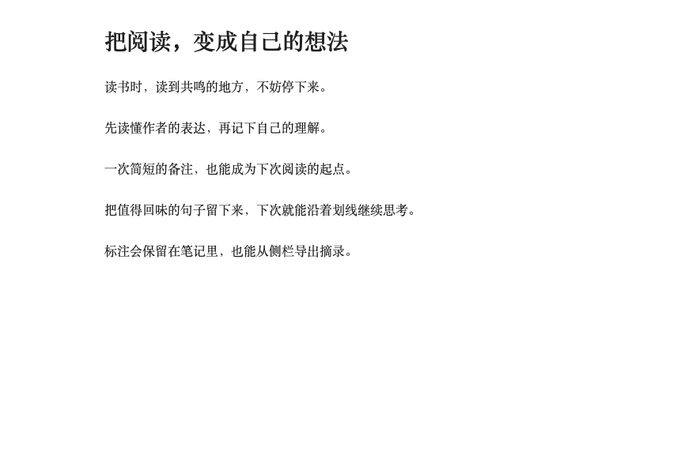
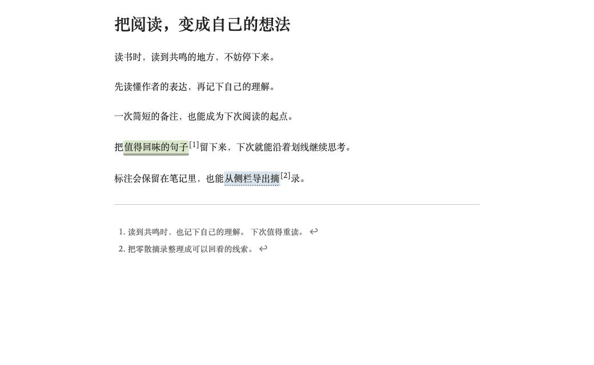

# Inkstone · 墨读

适合中文长文阅读和墨水屏的 Obsidian 浅色主题：安静阅读，随手划线、写想法，再把标注整理成摘录。

**[下载主题＋标注合集](https://github.com/bufan1024/obsidian-inkstone/releases/latest)** · **[安装与更新](INSTALL.md)** · **[标注使用说明](annotations/README.md)**

当前版本：**主题 1.3.6／标注插件 1.1.6**。白底、深灰正文，默认 1.75 倍行高、40em 行宽；字体和字号跟随 Obsidian「设置 → 外观」。只想阅读时，可以单独安装纯 CSS 主题。

## 看两段演示就能开始

动图录自 macOS Obsidian 1.14.4 的独立示例笔记库。点击动图可查看原尺寸。

### 选中文字，写想法



1. 选中普通文字，点击快捷条的「写想法」。
2. 在原文旁的小浮层中输入想法，选择四色高亮或下划线，再点「保存想法」（`Cmd+Enter`／`Ctrl+Enter`）。切换样式不丢文字，保存前不改笔记；取消不写入。
3. 点击已有标记，直接改色、写想法或删除。小菜单首层选色立即生效；进入「写想法／编辑想法」后，样式与备注在保存时一起生效。

动画无法播放时，查看[写想法截图](preview-selection-idea.png)、[已有标注菜单](preview-annotation-menu.png)，或按[完整示例教程](#用一篇示例走完标注侧栏和导出)练习。

### 在侧栏编辑标注，再导出摘录



1. 从快捷条「更多 → 打开标注侧栏」，或执行「墨读：打开标注侧栏」，查看当前笔记的摘录和想法。
2. 点击标注下的「编辑」，在按钮旁的小浮层首层选择颜色，立即改色。
3. 点击另一条标注的「编辑 → 写想法」，输入后点「保存想法」。已有备注时入口显示「编辑想法」；想法与浮层内所选样式在保存时一起生效，取消不写入。
4. 用顶部筛选框只看某一种颜色，再切回「全部标注」。滚动列表时，筛选和导出入口保持可见。
5. 点击「导出摘录」，在原笔记目录新建带来源链接的 Markdown。导出包含全部标注和备注，不受筛选影响；重名时加编号，不覆盖已有文件。

动画无法播放时，查看[侧栏截图](preview-workspace.png)和[侧栏与导出完整说明](annotations/README.md#当前笔记侧栏与摘录导出)。

## 安装与更新

下载并解压 [Release 合集](https://github.com/bufan1024/obsidian-inkstone/releases/latest)，或克隆仓库。**先关闭 Obsidian**，在解压目录或仓库目录运行（需要 Python 3）：

```sh
# 首次安装；可先加 --dry-run 查看计划
python3 scripts/install.py --vault "/你的笔记库路径"
# 更新已有安装，保留主题、配色与可读行宽偏好
python3 scripts/install.py --vault "/你的笔记库路径" --update
# 只更新插件，保留主题及阅读偏好
python3 scripts/install.py --vault "/你的笔记库路径" --update --plugin-only
```

首次完整安装会选用 Inkstone 浅色主题并开启可读行宽。重新打开 Obsidian，进入「设置 → 第三方插件」，关闭受限模式并**手动启用「墨读标注 Inkstone Annotations」**；安装脚本不会代为启用。只装主题可加 `--theme-only`，无需启用插件。

Windows 可用 `py -3` 代替 `python3`。脚本只处理指定库，替换前备份旧文件，保留插件 `data.json` 和其他插件设置。已有用户请加 `--update`；重复首次完整安装会重新选择主题与阅读偏好。不用命令行可按[手动安装、更新与恢复教程](INSTALL.md)操作。

## 用 Codex / AI 安装

将以下提示词复制给**能执行命令、访问本机文件**的 Codex 或 AI 编程助手，先替换笔记库绝对路径。在线聊天用户请使用[手动安装](INSTALL.md#手动安装)。

<details>
<summary>展开完整安装提示词</summary>

```text
请将 Inkstone 墨读主题和配套标注插件安装或更新到我的 Obsidian 笔记库：
/替换为你的笔记库绝对路径
配置文件夹：.obsidian（如已自定义，请先替换为实际名称）

仓库：https://github.com/bufan1024/obsidian-inkstone

请直接执行：
1. 读取仓库的 README.md 和 INSTALL.md，将仓库克隆到临时目录。
2. 检查上述路径和指定的配置文件夹存在，只检查我指定的笔记库。
   如果路径缺失或配置文件夹不明确，请先向我确认，不要猜测或扫描其他笔记库。
3. 检查指定配置目录中的 themes/Inkstone/ 和 plugins/inkstone-annotations/。
   如果已安装其中任一组件，运行安装脚本时加 --update，保留我的主题、配色和行宽偏好；
   如果两者都未安装，使用首次安装命令。
4. 先运行 python3 scripts/install.py --vault "上述绝对路径" --dry-run，
   再以相同参数去掉 --dry-run 执行。已安装时两次都加 --update；
   自定义配置目录时两次都加 --config-dir "文件夹名"。Windows 可用 py -3 代替 python3。
5. 不要修改笔记正文、删除文件、覆盖插件 data.json 或改动其他插件设置。
   脚本会备份被替换的文件，不要绕过它直接覆盖已有配置。
6. 检查主题和插件运行文件，告诉我安装或更新结果及实际备份位置，并提醒我重启 Obsidian。
   首次安装还需我在「设置 → 第三方插件」关闭受限模式并手动启用
   「墨读标注 Inkstone Annotations」；不要将脚本完成说成插件已经启用。

如果缺少 Git 或 Python 3，请说明缺少什么，并改用 Release 合集的手动安装方式。
不要安装到没有指定的笔记库，也不要只给我操作步骤。
```

</details>

## 日常使用

- 快捷条「划线」沿用最近样式，旁边的箭头可选四色或下划线，选择后立即保存。「写想法」新选区默认下划线，已有标注默认原样式，都可在保存前修改。
- 侧栏「编辑」在按钮旁打开与正文标记相同的小菜单：首层改颜色或下划线立即生效，写／编辑想法在同一浮层内保存，取消不写入。点击外部、按 `Esc` 或滚动可收起小浮层。
- 右键综合编辑入口、左侧荧光笔图标，以及「墨读：标注与备注／添加备注」命令仍打开完整面板。全部 13 个命令见[插件说明](annotations/README.md#完整命令与撤销)。
- 实时预览中，光标或选区离开标注后显示高亮；进入标注范围时显示源码。源码模式保持原样。删除标注保留原文，也保留其他位置仍在引用的共享脚注。
- 「墨读：上一屏／下一屏」和状态栏 ↑／↓ 按视口翻页并保留上下文。插件没有默认专属快捷键，可在「设置 → 快捷键」绑定。
- 编辑视图可用系统撤销；「墨读：撤销上次标注」只保留本次启用以来的最后一次标注操作，之后有其他编辑时请使用系统撤销。

## 用一篇示例走完标注、侧栏和导出

<details>
<summary>展开示例原文与完整五步操作</summary>

先启用 Inkstone Annotations，在笔记库中新建 `墨读标注与摘录演示.md`，复制以下原文；也可使用仓库的[划线与备注示例](examples/划线与备注示例.md)。

```markdown
# 墨读标注与摘录演示

好的标注，应该帮助下一次阅读接上思考。

读完一节后，写下一件今天就能试的小事。

遇到不确定的观点，先保留问题，再寻找证据。
```

从编辑视图或实时预览开始。macOS 按 `Cmd+P`、Windows 按 `Ctrl+P` 打开命令面板，输入「墨读」即可找到相关命令。

1. **写想法并加高亮。** 选中「好的标注」，点击快捷条的「写想法」，在小浮层内选择黄色并填写「重读时，先回到这句话。」，点击「保存想法」或按 `Cmd+Enter` / `Ctrl+Enter`，一次保存黄色高亮和脚注备注。输入期间切换样式不会丢失文字，也不会提前改写笔记。
2. **加下划线。** 选中「写下一件今天就能试的小事」，点击「划线」旁的箭头「划线样式」，选择「下划线」即保存；也可执行「墨读：添加下划线」。光标移开标注后，实时预览会显示标记；切换阅读视图也能看到效果。
3. **从原文管理标注。** 在阅读视图点击「好的标注」，原文旁会弹出小菜单，黄色显示为当前样式。点击蓝色即可改色；再次点击标记，选择「编辑想法」，在小菜单内修改备注，再点击「保存想法」或按 `Cmd+Enter` / `Ctrl+Enter`。点击外部、按 `Esc` 或滚动可收起；「删除标注」会保留原文，可在练习后用撤销恢复。
4. **查看侧栏。** 执行「墨读：打开标注侧栏」，可看到两条标注及第一条的备注。点击「定位原文」回到原文；点击「编辑」，按钮旁会出现相同的小菜单。选择「编辑想法」可修改备注，点「保存想法」保存，或点「取消」返回菜单而不改写笔记。小菜单首层选择样式会立即生效。顶部筛选框可分别选择「蓝色高亮」和「下划线」，再切回「全部标注」查看两条。
5. **导出摘录。** 点击侧栏中的「导出摘录」，或执行「墨读：导出当前笔记摘录」。同目录会新建并打开 `墨读标注与摘录演示-墨读摘录.md`，包含来源链接、两条标注原文和备注。导出包含当前笔记的全部标注，不受侧栏筛选影响；重名时添加编号，不覆盖已有摘录，也不改动原笔记。

导出后，侧栏跟随新打开的摘录笔记。摘录是普通 Markdown，显示「当前笔记暂无标注」属于正常情况；切回原示例标签页即可继续管理标注。摘录是导出时的副本，不随原文同步。

</details>

## 阅读设置

字体与字号在 Obsidian「设置 → 外观」调整，主题只使用设备已有字体，不下载外部资源。插件提供行高 1.5／1.75／2.0、行宽 32em／40em／48em；「恢复默认」跟随主题或 CSS，保留原生字体与字号。请开启「设置 → 编辑器 → 可读行宽」。

开启「墨水屏显示」后，四色统一为浅灰底，实线、双线、点线、虚线保留区别；**切换显示不改笔记中保存的颜色**。主题可独立使用，关闭插件后仍能显示已保存的标记与原生脚注。

<details>
<summary>CSS 自定义与静态效果图</summary>

在 `.obsidian/snippets/inkstone-reading.css` 写入以下内容，并在「设置 → 外观 → CSS 代码片段」启用：

```css
body.theme-light {
  --inkstone-line-height: 1.75;
  --inkstone-line-width: 40em;
  /* 可选：覆盖原生字号；要恢复原生控制，请移除此变量。 */
  --inkstone-font-size: 20px;
}
```

已有 `--inkstone-font-size` 自定义仍有效。使用 CSS 调行高、行宽时，将插件预设设为「跟随主题 / CSS」；窄窗口仍以可用宽度为限，宽表格与代码块各自横向滚动。

[阅读与侧栏](preview-workspace.png) · [实时预览](preview-live-preview.png) · [阅读设置](preview-reading-settings.png) · [选区工具条](preview-toolbar.png) · [完整标注面板](preview-annotations.png)

| 彩色高亮 | 墨水屏灰阶 |
| --- | --- |
|  |  |

[排版细节](preview-details.png) · [阅读排版示例](examples/阅读与排版示例.md)。阅读与交互截图来自 macOS Obsidian 1.14.4；彩色、灰阶及排版细节图来自此前的 1.12.4，内容均为仓库示例。

</details>

## 兼容与验证

最低 Obsidian 版本 **1.10.6**，主要适配浅色模式。本机验证使用 macOS **1.12.4 与 1.14.4**，覆盖阅读视图、实时预览、源码模式、标注交互、安装更新和打包，范围见[验证记录](VALIDATION.md)。窄屏与触控事件测试不等于手机原生应用或实体墨水屏验证，两类设备尚未实测；其他版本及第三方插件界面可能需要单独适配，刷新与残影由设备和系统决定。

标注只在本地处理，使用 HTML 标记与原生脚注保存。选区限同一源代码行的普通文字；阅读视图可在已有标记旁继续标注，含链接、加粗等复杂 Markdown 时请切到编辑视图。HTML 标签或属性、链接目标、代码、公式、属性区及跨源行等不安全选区会被拒绝。菜单打开后切换笔记或正文变化，需要重新选择后保存。

<details>
<summary>开发与打包</summary>

安装已构建文件无需 Node.js 或额外依赖。插件使用 [Obsidian 公开 API](https://github.com/obsidianmd/obsidian-api)，CodeMirror 模块由 Obsidian 提供。修改源码后，使用 Node.js 22 或更新版本：

```sh
node annotations/build.mjs
node --test annotations/tests/*.test.cjs
python3 -m unittest discover -s scripts -p 'test_*.py'
python3 scripts/package.py
```

构建与安装脚本无第三方包依赖，也不联网。`dist/` 输出独立主题、独立插件和合集三种 ZIP；`.qa/` 与 `dist/` 不纳入源码仓库。

</details>

## 设计参考与许可

排版与留白参考 OpenDesign 的 [Paper](https://github.com/nexu-io/open-design/blob/main/design-systems/paper/DESIGN.md)、[Editorial](https://github.com/nexu-io/open-design/blob/main/design-systems/editorial/DESIGN.md)、[Minimal](https://github.com/nexu-io/open-design/blob/main/design-systems/minimal/DESIGN.md)，结构参考 [Obsidian 官方主题文档](https://docs.obsidian.md/Themes/App+themes/Build+a+theme)。工具条文字动作参考[微信读书官方阅读页](https://weread.qq.com/web/reader/33332bf05cbba0333b1efb4)，按 Obsidian 功能适配。

[MIT License](LICENSE)。反馈问题请附 Obsidian 版本、系统、使用视图、最小笔记片段及其他 CSS 代码片段情况。
