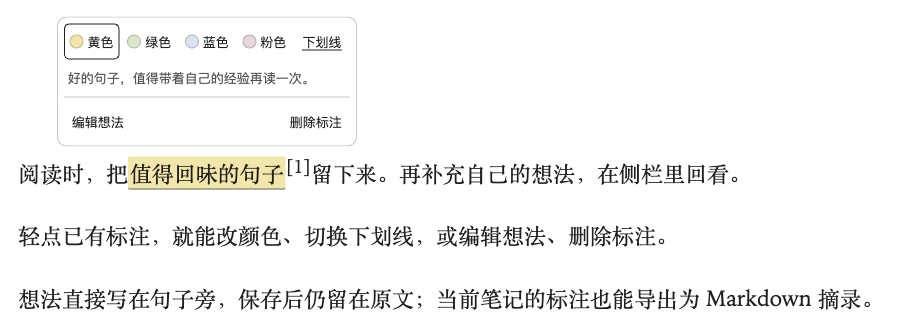
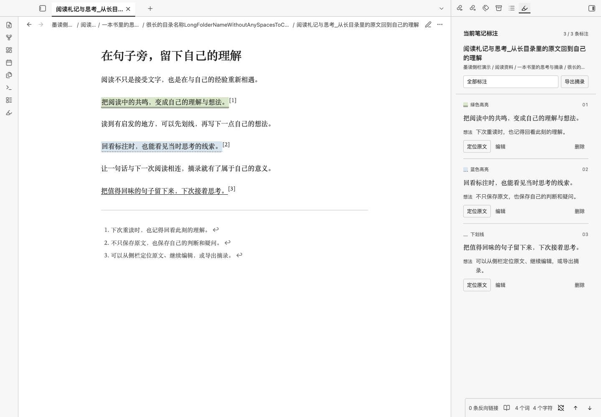
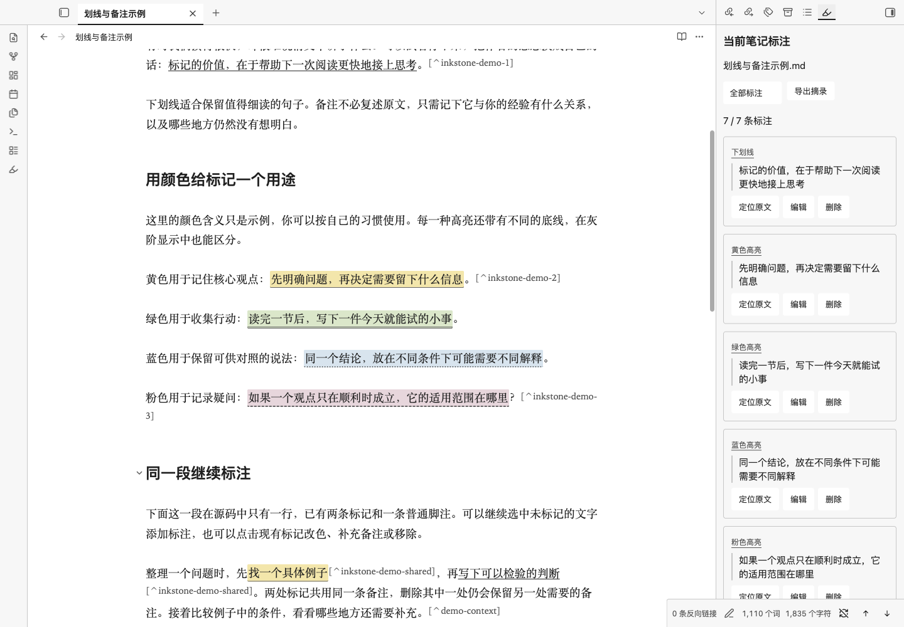
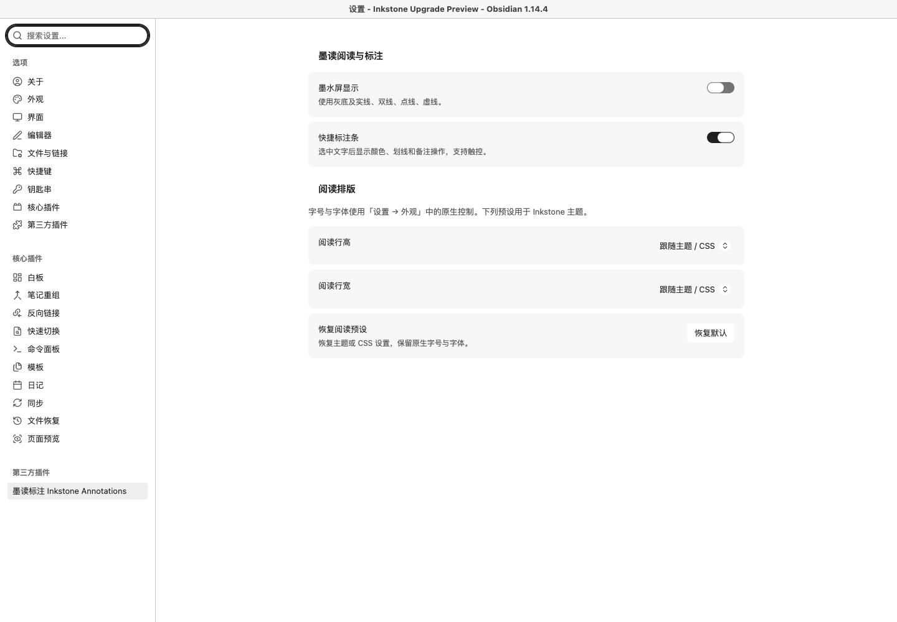
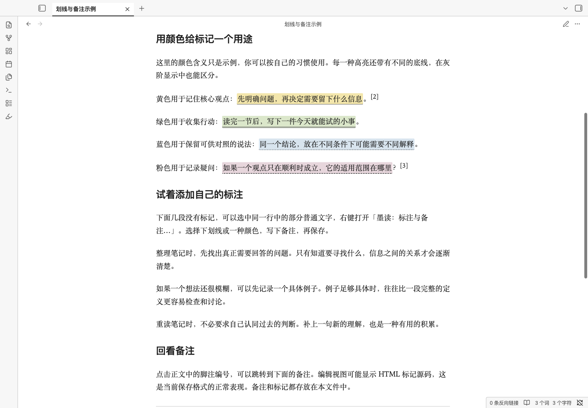
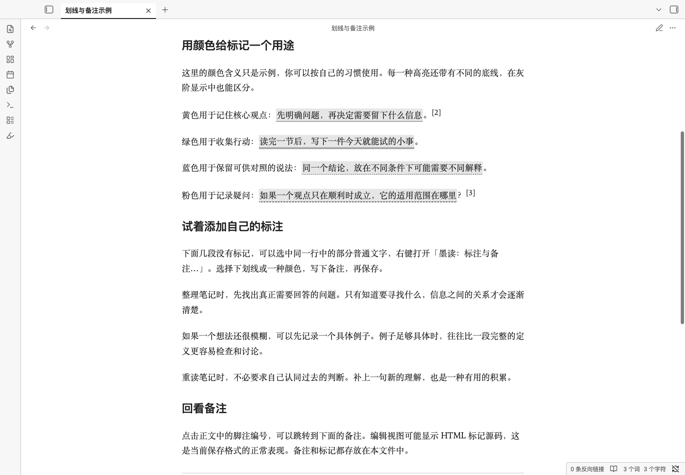
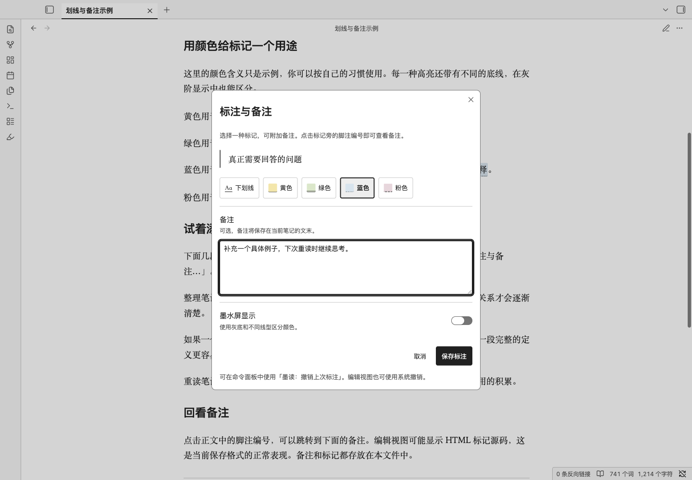
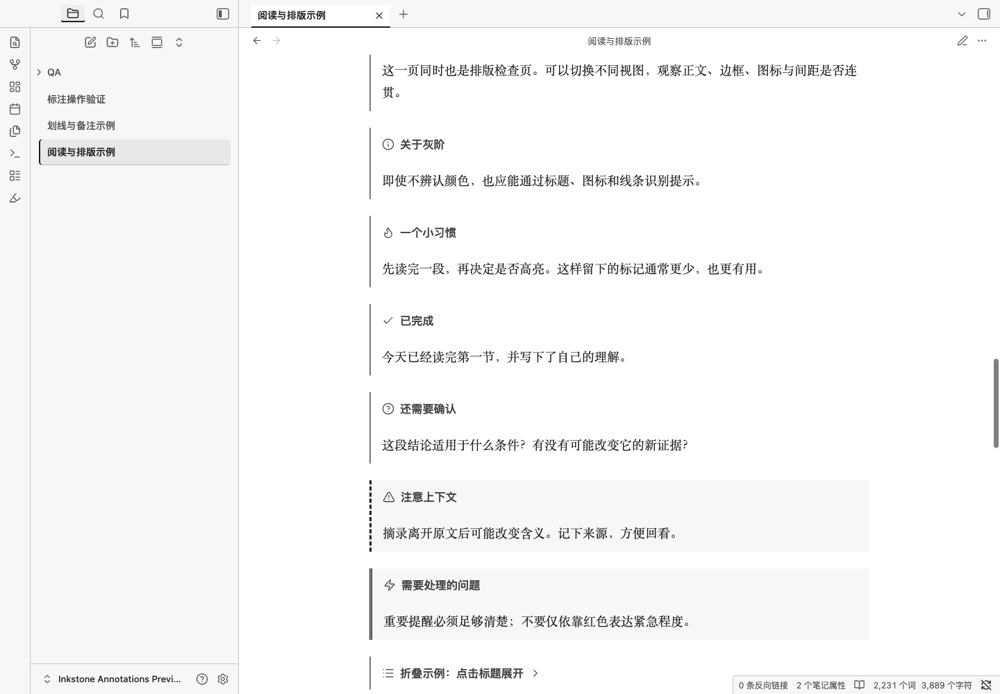

# Inkstone · 墨读

适合中文长文阅读和墨水屏的 Obsidian 浅色主题，附带可选的划线、高亮与备注插件。

当前版本为**主题 1.3.3、标注插件 1.1.3**。白底、深灰正文，默认 **1.75 倍行高、40em 行宽**，字号与字体跟随 Obsidian「设置 → 外观」。主题使用设备已有字体，不下载外部资源；插件只在本地处理笔记。

**[下载主题＋标注合集](https://github.com/bufan1024/obsidian-inkstone/releases/latest)** · **[安装与更新教程](INSTALL.md)** · **[标注使用说明](annotations/README.md)**

## 效果截图

新的阅读、实时预览和设置截图来自 macOS Obsidian 1.14.4；彩色、灰阶与排版细节图来自此前的 1.12.4，内容均为仓库附带的示例笔记。

### 选中文字后的操作

首层提供「复制」「划线」「写想法」和「更多」；划线旁的箭头展开样式面板，四色以小色点和文字表示，也可选下划线。以下截图来自 macOS Obsidian 1.14.4。


### 选中文字写想法

选中文字后点击「写想法」，直接在原文旁的小浮层中查看原文预览、输入多行备注。点击「保存想法」或按 `Cmd+Enter` / `Ctrl+Enter` 保存；「取消」不会写入笔记。新选区保存为下划线和脚注，已有标注保留原样式。


### 点击已有标注

点击阅读视图或实时预览中的高亮、下划线，会在原文旁弹出小菜单。直接选择颜色或下划线即可修改；「写想法／编辑想法」在菜单内输入备注，「删除标注」保留原文。侧栏的「编辑」与右键编辑入口仍提供完整面板。



### 阅读与当前笔记标注

在右侧查看当前笔记的标注，按颜色筛选，定位原文、编辑或删除，也可以导出为新的摘录笔记。



### 实时预览

未在编辑的标注显示高亮或下划线；光标或选区进入标注范围时显示源码，方便直接编辑。源码模式保持原样。



### 阅读设置

字号使用 Obsidian 原生设置，插件提供行高、行宽预设，以及快捷标注条和墨水屏显示开关。



### 彩色与墨水屏显示

开启「墨水屏显示」后，四色统一为浅灰底，用实线、双线、点线、虚线保留区别；切换显示不会改写笔记中保存的颜色。

| 彩色高亮 | 灰阶与不同线型 |
| --- | --- |
|  |  |

<details>
<summary>查看标注面板与排版细节</summary>





</details>

## 用 Codex / AI 安装

先关闭要安装或更新的 Obsidian 笔记库，再将下面的提示词复制给**能执行命令、访问本机文件**的 Codex 或其他 AI 编程助手。把路径替换为自己的笔记库绝对路径；如果只使用在线聊天，按[手动安装教程](INSTALL.md#手动安装)操作。

```text
请将 Inkstone 墨读主题和配套标注插件安装或更新到我的 Obsidian 笔记库：
/替换为你的笔记库绝对路径
配置文件夹：.obsidian（如已自定义，请先替换为实际名称）

仓库：https://github.com/bufan1024/obsidian-inkstone

请直接执行：
1. 读取仓库的 README.md 和 INSTALL.md，将仓库克隆到临时目录。
2. 检查上述路径和指定的配置文件夹存在，只检查我指定的笔记库。
   如果路径缺失或配置文件夹不明确，请先向我确认，不要猜测或扫描其他笔记库。
3. 检查指定配置目录中的 themes/Inkstone/ 和 plugins/inkstone-annotations/。
   如果已安装其中任一组件，运行安装脚本时加 --update，保留我的主题、配色和行宽偏好；
   如果两者都未安装，使用首次安装命令。
4. 先运行 python3 scripts/install.py --vault "上述绝对路径" --dry-run，
   再以相同参数去掉 --dry-run 执行。已安装时两次都加 --update；
   自定义配置目录时两次都加 --config-dir "文件夹名"。Windows 可用 py -3 代替 python3。
5. 不要修改笔记正文、删除文件、覆盖插件 data.json 或改动其他插件设置。
   脚本会备份被替换的文件，不要绕过它直接覆盖已有配置。
6. 检查主题和插件运行文件，告诉我安装或更新结果及实际备份位置，并提醒我重启 Obsidian。
   首次安装还需我在「设置 → 第三方插件」关闭受限模式并手动启用
   「墨读标注 Inkstone Annotations」；不要将脚本完成说成插件已经启用。

如果缺少 Git 或 Python 3，请说明缺少什么，并改用 Release 合集的手动安装方式。
不要安装到没有指定的笔记库，也不要只给我操作步骤。
```

首次完整安装会选用 Inkstone 浅色主题并开启可读行宽。**`--update` 更新不改主题、配色或行宽偏好**；`--plugin-only` 只处理插件文件，同样保留这些偏好。脚本不会自动启用第三方插件或关闭受限模式。只想阅读时可用 `--theme-only`，无需启用任何插件。

## 命令安装与更新

下载并解压 [Release 合集](https://github.com/bufan1024/obsidian-inkstone/releases/latest)，或克隆本仓库。在解压目录或仓库目录中运行（需要 Python 3，运行前关闭 Obsidian）：

```sh
# 首次安装主题与插件；可先加 --dry-run 查看计划
python3 scripts/install.py --vault "/你的笔记库路径"

# 更新已有安装，保留当前主题、配色和行宽偏好
python3 scripts/install.py --vault "/你的笔记库路径" --update

# 只更新标注插件，保留主题及阅读偏好
python3 scripts/install.py --vault "/你的笔记库路径" --update --plugin-only
```

Windows 可用 `py -3` 代替 `python3`。脚本仅写入指定库的配置目录，替换前备份内容不同的旧文件；保留插件的 `data.json` 和其他插件设置。再次运行首次安装命令会重新选用 Inkstone、浅色配色与可读行宽，已有用户请使用 `--update`。

不用命令行也可安装：将合集中的 `themes/Inkstone/` 和 `plugins/inkstone-annotations/` 分别复制到笔记库的 `.obsidian/themes/` 与 `.obsidian/plugins/`，然后在 Obsidian 中选择主题、手动启用插件。详见[安装、更新与恢复教程](INSTALL.md)。

## 划线、高亮与备注

启用插件后，选中普通文字，使用快捷标注条、右键「墨读：标注与备注…」，或命令面板中的同名命令。

- 下划线、黄／绿／蓝／粉四色高亮，可附多行备注。备注作为原生脚注保存在当前笔记。
- 同一段可继续标注未标记的文字，已有 Inkstone 标记和脚注不会阻止操作。阅读视图仍要求该段原文位于**单个源代码行**；含链接、加粗等复杂 Markdown 时，请切换编辑视图选择普通文字。
- 点击阅读视图或实时预览中的现有标记，在原文旁的小菜单中改色、切换下划线、写想法或删除，无需打开完整面板。当前样式会有选中提示；修改备注保留现有样式，删除保留原文及其他位置仍在引用的共享脚注。
- 有效选区后显示快捷条：「复制」复制原文，「划线」沿用最近样式，旁边的箭头「划线样式」可选四色高亮或下划线，选择后立即保存。「写想法」直接打开小浮层，显示原文预览并支持多行输入；保存新选区时添加下划线与脚注，已有标注保留原样式。「更多」可打开侧栏或导出摘录。可在插件设置中关闭快捷条。
- 「墨读：打开标注侧栏」显示当前笔记的摘录、颜色和备注，支持筛选、定位、编辑和删除。
- 「墨读：导出当前笔记摘录」在原笔记所在目录新建 Markdown，包含全部标注、备注及来源链接，重名时添加编号，不覆盖已有文件。
- 「墨读：上一屏／下一屏」和状态栏的 ↑／↓ 按钮按视口翻页，保留少量上下文并立即滚动。没有默认快捷键，可自行绑定。
- 编辑视图可用系统撤销；「墨读：撤销上次标注」仅保留本次启用插件以来的最后一次标注操作，后续有其他编辑时须使用系统撤销。

「墨读：标注与备注」「墨读：添加备注」、右键综合编辑入口和左侧荧光笔图标仍使用完整面板。插件会拒绝 HTML 标签或属性、链接目标、代码、公式、属性区和跨源行等不安全选区。菜单或面板打开后如切换笔记或正文发生变化，需要重新选择后保存。完整的 13 个命令及适用范围见[插件说明](annotations/README.md)。

主题仍是纯 CSS，可独立使用。关闭插件后，Inkstone 仍可显示已保存的标记与原生脚注。复制[划线与备注示例](examples/划线与备注示例.md)到笔记库即可练习。

## 用一篇示例走完标注、侧栏和导出

先启用 Inkstone Annotations 插件，在笔记库中新建 `墨读标注与摘录演示.md`，复制以下原文：

```markdown
# 墨读标注与摘录演示

好的标注，应该帮助下一次阅读接上思考。

读完一节后，写下一件今天就能试的小事。

遇到不确定的观点，先保留问题，再寻找证据。
```

下面的操作从编辑视图或实时预览开始。macOS 按 `Cmd+P`、Windows 按 `Ctrl+P` 打开命令面板，输入「墨读」即可找到这些命令；插件没有默认专属快捷键，可在「设置 → 快捷键」中自行绑定。

1. **写想法并加高亮。** 选中「好的标注」，点击快捷条的「写想法」，在小浮层内填写「重读时，先回到这句话。」，点击「保存想法」或按 `Cmd+Enter` / `Ctrl+Enter`，会保存为下划线和脚注。再在阅读视图点击这条标记，在小菜单中选择黄色，即可改成黄色高亮并保留想法。
2. **加下划线。** 选中「写下一件今天就能试的小事」，点击「划线」旁的箭头「划线样式」，选择「下划线」即保存；也可执行「墨读：添加下划线」。光标移开标注后，实时预览会显示标记；切换阅读视图也能看到效果。
3. **从原文管理标注。** 在阅读视图点击「好的标注」，原文旁会弹出小菜单，黄色显示为当前样式。点击蓝色即可改色；再次点击标记，选择「编辑想法」，在小菜单内修改备注，再点击「保存想法」或按 `Cmd+Enter` / `Ctrl+Enter`。点击外部、按 `Esc` 或滚动可收起；「删除标注」会保留原文，可在练习后用撤销恢复。
4. **查看侧栏。** 执行「墨读：打开标注侧栏」，可看到两条标注及第一条的备注。点击「定位原文」回到原文；需要完整面板时点击「编辑」。顶部筛选框可分别选择「蓝色高亮」和「下划线」，再切回「全部标注」查看两条。
5. **导出摘录。** 点击侧栏中的「导出摘录」，或执行「墨读：导出当前笔记摘录」。同目录会新建并打开 `墨读标注与摘录演示-墨读摘录.md`，包含来源链接、两条标注原文和备注。导出包含当前笔记的全部标注，不受侧栏筛选影响；重名时添加编号，不覆盖已有摘录，也不改动原笔记。

导出后，侧栏会跟随新打开的摘录笔记。摘录是普通 Markdown，因此侧栏显示「当前笔记暂无标注」属于正常情况；切回原示例标签页，就能继续管理原来的两条标注。

## 字体与阅读尺寸

在 Obsidian「设置 → 外观」中调整正文字体和字号。主题默认使用设备已有字体，不下载在线字体。插件的「阅读行高」提供 1.5、1.75、2.0，「阅读行宽」提供 32em、40em、48em；「恢复默认」会回到主题或 CSS 设置，保留原生字号与字体。

也可以在 `.obsidian/snippets/inkstone-reading.css` 中写入以下内容，再在「设置 → 外观 → CSS 代码片段」启用：

```css
body.theme-light {
  --inkstone-line-height: 1.75;
  --inkstone-line-width: 40em;
  /* 可选：显式覆盖原生字号；不需要时删除这一行。 */
  --inkstone-font-size: 20px;
}
```

已有 `--inkstone-font-size` 自定义仍然有效；要恢复原生字号控制，请移除该变量。使用 CSS 设置行高、行宽时，将插件预设选为「跟随主题 / CSS」。请开启「设置 → 编辑器 → 可读行宽」；窄窗口仍以可用宽度为限。

## 兼容与验证

主题与插件最低 Obsidian 版本为 **1.10.6**。本机验证环境为 macOS **1.12.4 与 1.14.4**，覆盖阅读视图、实时预览、源码模式、标注交互、安装更新及打包；测试结果与范围见[验证记录](VALIDATION.md)。宽表格和代码块在各自区域横向滚动。

主要适配浅色模式。窄屏布局和触控事件测试不等于手机原生应用或实体墨水屏验证，这两类设备尚未实测；其他 Obsidian 版本和第三方插件界面也可能需要单独适配。设备刷新和残影由设备与系统决定。

## 开发与打包

使用仓库已构建的文件安装时，无需 Node.js 或额外依赖。插件使用 Obsidian 公开 API，CodeMirror 模块由 Obsidian 提供，用户无需另行安装。修改源码后，用 Node.js 22 或更新版本重新构建和测试：

```sh
node annotations/build.mjs
node --test annotations/tests/*.test.cjs
python3 -m unittest discover -s scripts -p 'test_*.py'
python3 scripts/package.py
```

构建和安装脚本无第三方包依赖，也不联网。发布包生成到 `dist/`，包含独立主题、独立插件、主题与标注合集三种 ZIP。`.qa/` 与 `dist/` 不纳入源码仓库。

## 设计参考与许可

排版与留白参考 OpenDesign 的 [Paper](https://github.com/nexu-io/open-design/blob/main/design-systems/paper/DESIGN.md)、[Editorial](https://github.com/nexu-io/open-design/blob/main/design-systems/editorial/DESIGN.md) 和 [Minimal](https://github.com/nexu-io/open-design/blob/main/design-systems/minimal/DESIGN.md)，主题结构参考 [Obsidian 官方主题开发文档](https://docs.obsidian.md/Themes/App+themes/Build+a+theme)。

选区工具条的「复制／划线／写想法」文字动作参考[微信读书官方阅读页](https://weread.qq.com/web/reader/33332bf05cbba0333b1efb4)；样式面板和「更多」菜单的层级按 Obsidian 插件功能适配。

[MIT License](LICENSE)。问题反馈请附 Obsidian 版本、系统、使用视图、最小笔记片段及其他 CSS 代码片段情况。
